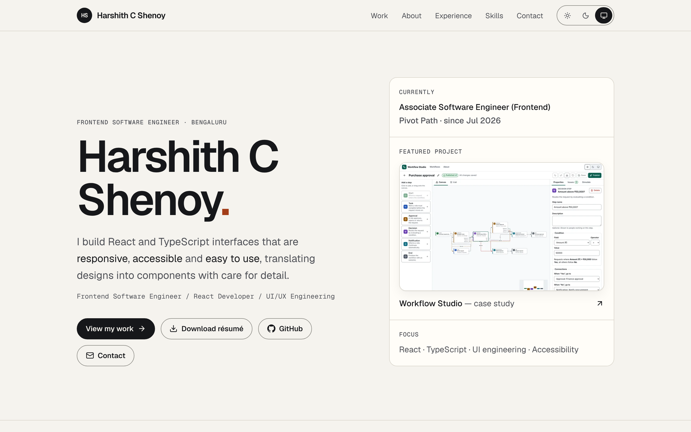
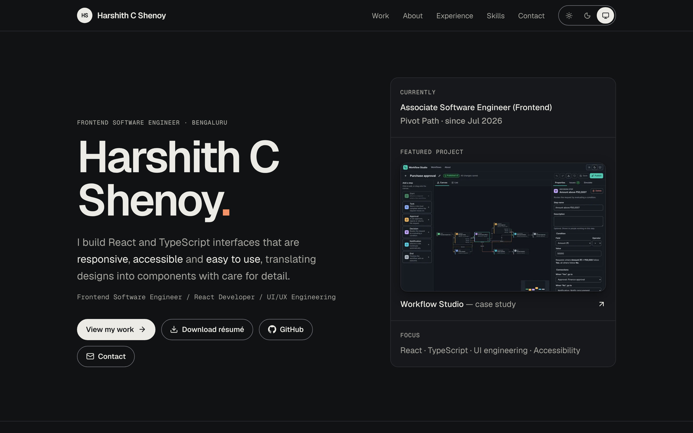
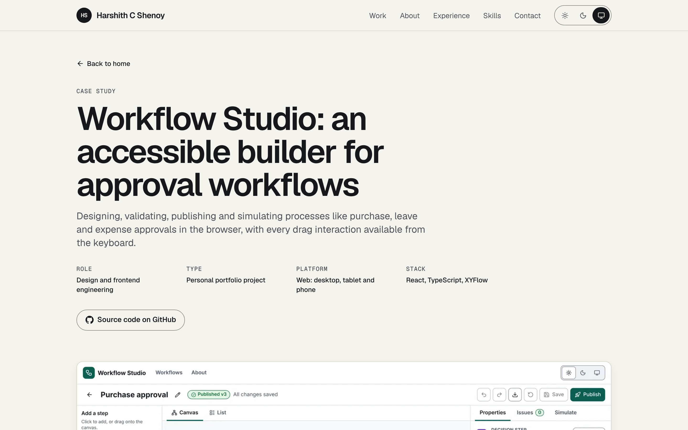
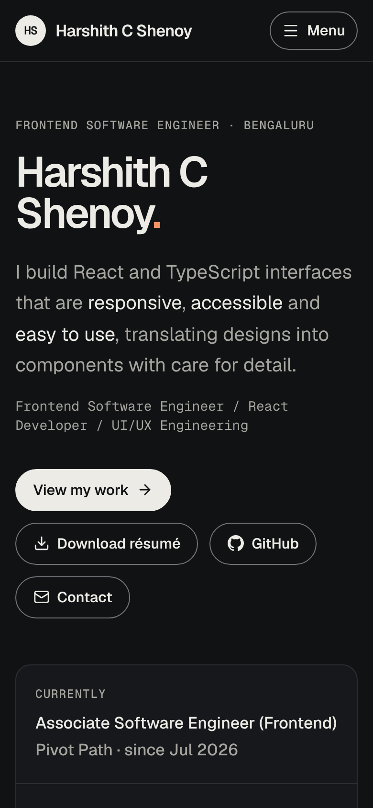

# Harshith C Shenoy — Developer Portfolio

**Live:** https://mahamaharati-lgtm.github.io/Portfolio/

Personal portfolio of **Harshith C Shenoy**, Frontend Software Engineer (React · TypeScript · UI/UX engineering), with an in-depth case study of [Workflow Studio](../workflow-studio).



| Dark theme                                                | Case study                                                                | Mobile                                                                      |
| --------------------------------------------------------- | ------------------------------------------------------------------------- | --------------------------------------------------------------------------- |
|  |  |  |

## What's inside

- **Home:** hero, featured project (Workflow Studio, with real screenshots that follow the active theme), about, experience in reverse chronological order, grouped skills (no percentage bars), education, contact (email, copy-to-clipboard, GitHub) and résumé downloads (PDF and DOCX)
- **Case study** (`/projects/workflow-studio`): 17 sections from product overview to future improvements, written only from the actual implementation and test results
- **404** page

## Content rules

All personal facts live in [`src/content/profile.ts`](src/content/profile.ts), and project facts live in [`src/content/workflowStudio.ts`](src/content/workflowStudio.ts). Only verified information belongs there. In particular:

- Employment `highlights` are empty on purpose. Add verified responsibilities and they render automatically.
- `linkedin` stays `null` until a verified URL is available.
- The phone number is in the résumé only and is never shown on the site.
- The Workflow Studio **Live demo** buttons appear only when `VITE_WORKFLOW_STUDIO_URL` is set at build time.

## Tech

React 19, TypeScript (strict), Vite 8, Tailwind CSS 4, React Router 8, Lucide icons, and self-hosted Geist and Geist Mono variable fonts.

- **Pre-rendered:** `scripts/prerender.mjs` renders each route to static HTML at build time with `react-dom/server`, and the client then hydrates it. Content is readable without JavaScript and paints immediately.
- **Themes:** Light, Dark and System, built on semantic CSS tokens. An inline head script prevents a theme flash. `useSyncExternalStore` keeps the switcher hydration-safe, follows OS changes live, and syncs across tabs.
- **Accessibility:** skip link, landmarks, one `h1` per page, focus moved to the heading after route changes, visible focus rings, an accessible mobile menu (`aria-expanded`, Escape to close, focus returned to the button), live-region feedback for copy-email, reduced-motion support, and reflow down to 320px and at 200% text size.

## Getting started

```bash
npm install
npm run dev
```

| Command                                 | Purpose                                                                                                  |
| --------------------------------------- | -------------------------------------------------------------------------------------------------------- |
| `npm run build`                         | Type-check, build the client and SSR bundles, and pre-render pages to `dist/`                            |
| `npm run preview`                       | Serve `dist/` on port 4173                                                                               |
| `npm run lint` / `npm run format:check` | ESLint / Prettier                                                                                        |
| `npm test`                              | Vitest unit and component tests                                                                          |
| `npm run test:e2e`                      | Playwright: content, navigation, mobile menu, themes, résumé downloads, links, axe and responsive checks |

Optional build-time environment variables:

| Variable                   | Effect                                                                  |
| -------------------------- | ----------------------------------------------------------------------- |
| `VITE_WORKFLOW_STUDIO_URL` | Shows the "Live demo" buttons for Workflow Studio                       |
| `SITE_URL`                 | Adds canonical links, `sitemap.xml` and a sitemap entry in `robots.txt` |

## Test results (latest local run)

- Vitest: 5 tests passing
- Playwright: 21 tests passing, including axe-core (WCAG 2.0/2.1 A and AA) on the home, case study, 404 and mobile menu views in both light and dark (0 violations), and no horizontal scroll at 320, 375, 768, 1024, 1440 and 1920px

## Lighthouse (local production build, Lighthouse 13.6, 3 Nov 2026)

| Page                 | Performance | Accessibility | Best practices | SEO |
| -------------------- | ----------- | ------------- | -------------- | --- |
| Home (mobile)        | 100         | 100           | 100            | 100 |
| Case study (mobile)  | 100         | 100           | 100            | 100 |
| Home (desktop)       | 100         | 100           | 100            | 100 |
| Case study (desktop) | 100         | 100           | 100            | 100 |

These were measured against `vite preview` in headless Chromium. Scores on the deployed site may differ.

## Deployment

The live site is published to GitHub Pages by the repository's `deploy-pages` workflow (see the root README). To deploy this app on its own to Cloudflare Pages instead, use:

### Cloudflare Pages

| Setting               | Value                                                                        |
| --------------------- | ---------------------------------------------------------------------------- |
| Root directory        | `developer-portfolio`                                                        |
| Build command         | `npm run build`                                                              |
| Output directory      | `dist`                                                                       |
| Environment variables | `NODE_VERSION=22`, plus optionally `VITE_WORKFLOW_STUDIO_URL` and `SITE_URL` |

Pre-rendered pages are emitted as `index.html`, `projects/workflow-studio.html` and `404.html`. Cloudflare Pages serves these at clean URLs and uses `404.html` for unknown paths. `public/_headers` sets security and caching headers.

## Accessibility notes

Automated checks (axe-core, Lighthouse) report no issues, and keyboard use was verified manually and in Playwright. I have not yet tested with real screen readers (NVDA, JAWS, VoiceOver), so this is not a claim of full WCAG conformance.
