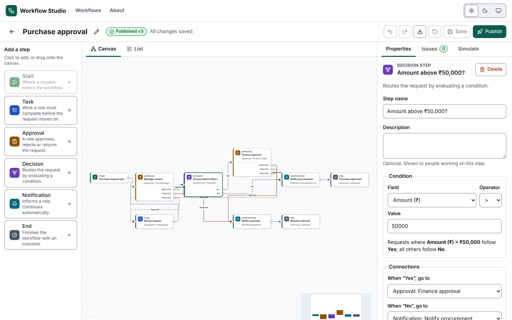
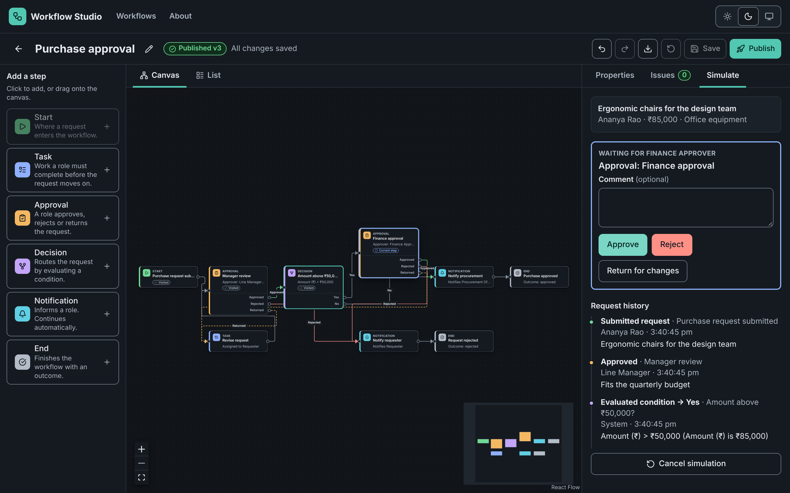
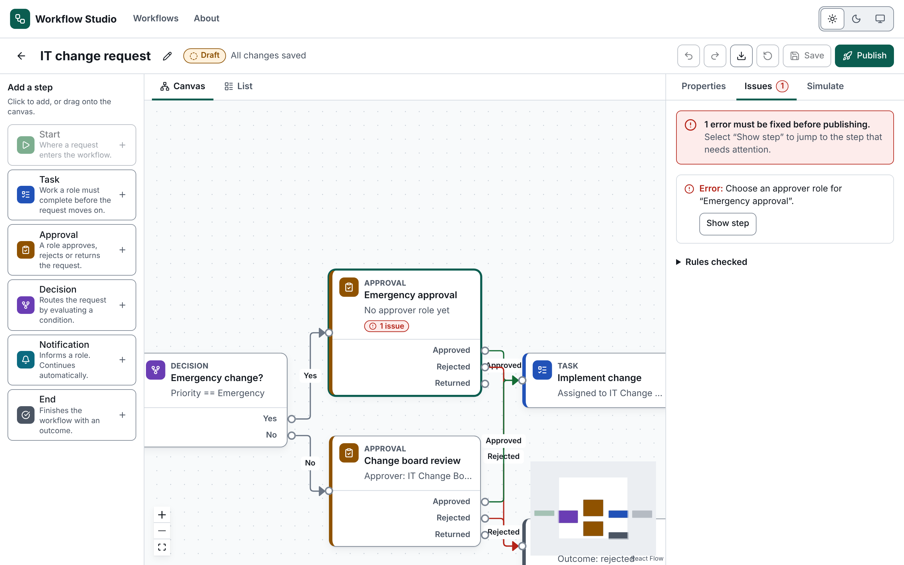
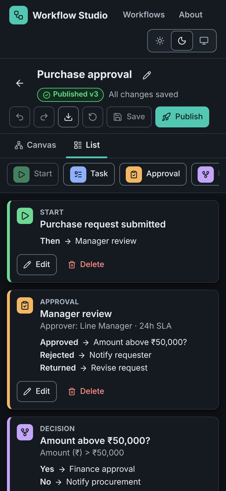

# Workflow Studio

**Live:** https://mahamaharati-lgtm.github.io/Portfolio/workflow-studio/

An accessible, browser-based builder for enterprise approval workflows: purchase approvals, leave requests, expense reimbursements, document sign-off and IT change requests.

Design a workflow on a canvas (or as a structured list), check it against business rules, publish it, and simulate a real request step by step, with a full audit-style history.

> **Demo scope:** this is a front-end application. Workflows and simulation runs are stored in the browser's `localStorage`. There is no backend, authentication, multi-user collaboration or real notification delivery.



| Simulation (dark)                                                                                               | Validation (light)                                                                           | Mobile list editor (dark)                                              |
| --------------------------------------------------------------------------------------------------------------- | -------------------------------------------------------------------------------------------- | ---------------------------------------------------------------------- |
|  |  |  |

## Features

**Workflow management**

- List, search and filter workflows by status (draft or published)
- Create from a blank canvas or one of five example processes, then rename, duplicate or delete (with confirmation)
- Draft and published states with version numbers. Editing a published workflow creates a new draft.
- Import and export workflow definitions as JSON, validated with Zod on import
- Save explicitly (button or Ctrl/⌘+S), discard unsaved changes, and get a warning before leaving with unsaved work

**Editor**

- Drag-and-drop canvas built on [XYFlow](https://reactflow.dev/) with Start, Task, Approval, Decision, Notification and End steps
- Add steps by clicking or dragging from the palette; delete steps or connections
- Connect named outputs: Approved / Rejected / Returned on approvals, Yes / No on decisions
- Property panel for names, descriptions, assignee/approver/recipient roles, SLA hours, decision conditions and end outcomes
- Zoom, pan, fit-to-view and minimap
- Undo/redo, with rapid typing and node drags grouped into single steps
- **List view**: the same workflow as an ordered, fully keyboard-operable list (default on phones)

**Validation (blocks publishing)**

- Exactly one Start step, and at least one reachable End step
- Every step reachable from Start and able to reach an End step
- Required roles configured on tasks, approvals and notifications
- Decisions need a valid condition (numbers for amount/days, `==`/`!=` for text) and both branches
- Approvals need Approved and Rejected branches
- No self-connections, duplicate outputs, dangling connections, or connections into Start
- Loops are only allowed through an approval's _Returned_ branch
- Warning when both branches of a decision lead to the same step

**Simulation**

- Enter a sample request (title, requester, amount in ₹, days, category, priority)
- Decisions and notifications run automatically; you act as each assignee or approver (approve, reject, return for changes, complete task) with optional comments
- The current step is highlighted on the canvas, and the request history records every action, actor and decision result
- The last 10 runs per workflow are kept

### The ₹85,000 purchase request

1. Open **Purchase approval** and choose **Simulate**. The sample request is ₹85,000.
2. **Start simulation**: the request is submitted and waits for the _Line Manager_.
3. **Approve**: the decision _Amount above ₹50,000?_ evaluates to **Yes**, so the request moves to _Finance approval_.
4. **Approve** again: _Procurement Officer_ is notified and the workflow ends as **Approved**.
5. Try ₹20,000 instead, and the finance step is skipped. **Return for changes** sends the request to the requester; **Reject** ends it as rejected.

## Tech stack

React 19 · TypeScript (strict) · Vite 8 · Tailwind CSS 4 · React Router 8 · @xyflow/react 12 · Zustand 5 · React Hook Form + Zod 4 · Radix Dialog · Lucide icons · Vitest + React Testing Library · Playwright + axe-core · ESLint + Prettier

Motion for React was deliberately left out: the interface uses short CSS transitions that are disabled under `prefers-reduced-motion`, so an animation library would add bundle weight without user value.

## Architecture

```
src/
  domain/        Pure, framework-free logic (fully unit-tested)
    types.ts         Workflow, node, edge and simulation types
    nodeMeta.ts      Per-node-type outputs, defaults, labels
    validation.ts    Business-rule validation
    connections.ts   Connection rules shared by canvas and keyboard editor
    simulation.ts    Step-by-step execution engine
    schema.ts        Zod schema for JSON import (lazy-loaded)
    templates.ts     Example workflows
  store/
    workflows.ts     Persisted workflow + run storage (Zustand persist, safe localStorage wrapper)
    editor.ts        Editing session: draft, undo/redo history, selection, simulation
    toast.ts         Visible toasts + screen-reader announcements
  theme/         Light / Dark / System theme provider and switcher
  components/    UI: canvas, custom node, palette, panels, list editor, dialogs
  routes/        Workflows list, editor (lazy-loaded), about, not-found
```

- The **domain layer** has no React dependencies. The canvas, the list view and the property panel all edit the same draft through the editor store, so mouse, touch and keyboard paths share one set of rules.
- **Performance:** the editor route, the canvas, the form dialogs and the Zod import validator load on demand. The workflow list ships about 129 kB of gzipped JS.

## Theming

- Three options (Light, Dark, System) via a native radio group. The choice persists in `localStorage` (`ws-theme`) and syncs across tabs.
- An inline script in `index.html` applies the theme before first paint, so there is no flash.
- _System_ follows OS changes live (`matchMedia` + `useSyncExternalStore`).
- All colours are semantic CSS tokens (`--surface`, `--fg`, `--accent`, `--danger`, node colours and more), redefined under `[data-theme='dark']`. React Flow's CSS variables map onto the same tokens.

## Accessibility

Target: WCAG 2.1 AA. What was implemented and verified:

- Skip link, landmarks, logical heading structure, and focus moved to the page heading after client-side navigation
- Visible 3px focus rings in both themes; no keyboard traps (dialogs trap focus intentionally and close with Escape)
- Dialogs (Radix) move focus to the first field and return focus to the triggering control on close
- Form fields have labels, hints and inline errors linked with `aria-describedby` and `aria-invalid`
- Status updates (saves, connections, simulation steps) are announced through polite live regions
- Status, severity, outcomes and edge meanings always carry text and icons, never colour alone
- **Keyboard alternatives to dragging:** steps can be focused (Tab), selected (Enter), moved (arrow keys) and deleted (Delete) on the canvas; connections are made with the _Connections_ selects in the property panel; the List view offers full editing without the canvas
- ARIA tabs with arrow/Home/End navigation
- Reduced-motion support; reflow verified at 320px and with 200% root font size

**Automated checks:** axe-core (WCAG 2.0/2.1 A and AA rules) runs in Playwright against the list, create dialog, about page, canvas, properties with errors, list view, and simulation in progress and complete, in both light and dark themes. There are 0 violations in the current build.

**Known limitations:** automated tools cannot prove conformance. I have checked keyboard operation manually and through automated tests, but I have not done screen-reader testing with NVDA, JAWS or VoiceOver. Canvas edge dragging itself is pointer-only; the property panel and List view are the documented equivalents. React Flow's minimap is hidden below 1280px.

## Test results (latest local run)

- Vitest: 44 unit and component tests in 6 files, all passing
- Playwright: 29 end-to-end tests, all passing, covering workflow management, canvas mouse and keyboard, simulations, themes, keyboard-only use, axe-core (light and dark) and responsive layouts

## Lighthouse (local production build, Lighthouse 13.6, 3 Nov 2026)

| Page                    | Performance | Accessibility | Best practices | SEO |
| ----------------------- | ----------- | ------------- | -------------- | --- |
| Workflow list (mobile)  | 100         | 100           | 100            | 100 |
| Editor (mobile)         | 96          | 100           | 100            | 100 |
| Workflow list (desktop) | 100         | 100           | 100            | 100 |
| Editor (desktop)        | 100         | 100           | 100            | 100 |

These were measured against `vite preview` in headless Chromium. The editor's simulated-mobile LCP is 2.7 s because the canvas library loads with the route. Scores on the deployed site may differ.

## Getting started

Requires Node.js 22.22+.

```bash
npm install
npm run dev          # http://localhost:5173
```

## Scripts

| Command                                 | Purpose                                                                                     |
| --------------------------------------- | ------------------------------------------------------------------------------------------- |
| `npm run build`                         | Type-check and build to `dist/`                                                             |
| `npm run preview`                       | Serve the production build                                                                  |
| `npm run lint` / `npm run format:check` | ESLint / Prettier                                                                           |
| `npm test`                              | Vitest unit and component tests                                                             |
| `npm run test:e2e`                      | Playwright e2e, axe, theme, keyboard and responsive tests (builds and serves automatically) |
| `npm run screenshots`                   | Regenerate `docs/screenshots` (needs a preview server on port 4173)                         |

## Deployment

The live site is published to GitHub Pages by the repository's `deploy-pages` workflow (see the root README). To deploy this app on its own to Cloudflare Pages instead, use:

### Cloudflare Pages

| Setting              | Value             |
| -------------------- | ----------------- |
| Root directory       | `workflow-studio` |
| Build command        | `npm run build`   |
| Output directory     | `dist`            |
| Environment variable | `NODE_VERSION=22` |

`public/_redirects` provides SPA fallback routing, and `public/_headers` sets security and caching headers.

## Example data

All people, requests and amounts are fictional.
